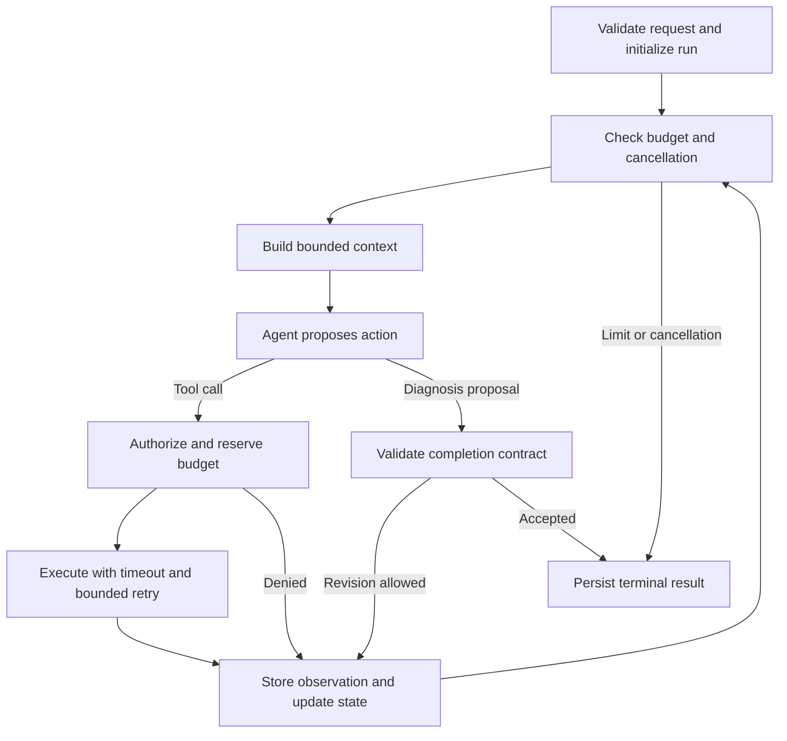

# TraceMind single-agent design

## Priority and current status

The next milestone is a reliable, observable single-agent diagnosis service.
Multi-agent orchestration follows an evaluated single-agent baseline.
The capabilities below are planned work unless explicitly marked current.

Current code provides a `create_agent` tool loop, four read-only telemetry
tools, normalized evidence, structured output, and one payment-failure case.
S1 adds per-run state, a tool registry and tool-name allowlist, model/tool call
budgets, identical-query limits, model/tool/run timeouts, completion checks,
and structured JSONL events. API and evaluation use the same controls; the
case's tool budget also constrains execution. Scripted-model tests exercise the
real agent loop, parallel admission, cancellation, isolation, and failure paths.

There is no context-token budget, resumable checkpoint, cross-incident memory,
service/tenant authorization, automatic retry/fallback, or full payload trace
yet. S1 disables SDK retries and records provider usage when available. Its
event files contain operational metadata and evidence IDs, not full observations
or recoverable graph state. Console truncation only affects printed output.
Trace file I/O failures produce a server warning while preserving in-memory
events and the primary run outcome. Expected external errors are classified as
model/tool errors; unexpected implementation errors retain `internal_error`
and their exception chain. API error `detail` stays a string, with run metadata
in response headers; timezone-aware inputs remain required.

## Agent and workflow responsibilities

One diagnostic agent chooses queries, interprets evidence, revises hypotheses,
and proposes conclusions. Application code owns execution and termination.

| Step | Owner | Contract |
| --- | --- | --- |
| Validate incident and resolve scope | Workflow | Scope comes from trusted configuration or authenticated identity |
| Load state and compose context | Workflow | Apply context budget, evidence selection, and prompt version |
| Propose query or diagnosis | Agent | Structured proposal with evidence references |
| Authorize and execute tools | Workflow | Validate arguments, scope, budgets, timeout, and retry policy |
| Normalize and store observations | Workflow | Preserve provenance and return bounded evidence |
| Interpret evidence and choose follow-up | Agent | Distinguish observations, hypotheses, and missing information |
| Accept diagnosis or request revision | Workflow | Validate completion contract and bound repair attempts |
| Stop and publish result | Workflow | Persist terminal status, stop reason, and partial results |

Initially retain `create_agent` and use middleware for model/tool interception
and custom state. Add explicit graph nodes where tested requirements cannot be
expressed clearly through these hooks. Verify APIs against locked dependencies.

## 1. Context engineering

Compose model input from four layers:

1. Versioned system instructions: diagnostic method, evidence requirements,
   uncertainty, untrusted-data boundaries, and output contract.
2. Run context: incident, fixed time window, available tools, remaining budget,
   and policy feedback. Credentials stay outside model context.
3. Working notes: hypotheses, supporting/contradicting evidence IDs, completed
   queries, unresolved questions, and intended next checks.
4. Selected evidence and recent complete model/tool exchanges.

Store observations outside the prompt. Return bounded summaries, provenance,
and references for detail retrieval. Normalize, filter, deduplicate, and cap
fields/results before selecting relevant evidence. Preserve contradictions.
Deduplication must consider trace/span identity, timestamps, metric labels,
and error details; identical summary text does not establish duplication.

Summarize older exchanges only when needed. Keep tool-call/result pairs valid,
including pending responses. Summaries retain evidence IDs and never become
new observed evidence. On summary failure, use deterministic selection and
stored-detail references, or terminate with a context-limit reason. Any summary
model performs a bounded transformation without investigation tool access.

Budget the full input, including tool schemas, and reserve response tokens.
Distinguish estimates from provider usage. Measure evidence retention and
diagnostic accuracy after compression.

## 2. Run state and persistence

Introduce single-agent `RunState`: run/thread IDs, incident and time window,
access scope, lifecycle status, deadline, cancellation, bounded messages,
working notes, evidence references, pending calls, call/attempt ledger, usage,
failures, remaining budgets, diagnosis proposal, and stop reason. Record model,
prompt, policy, tool-schema, and application versions for reproducibility.

Run statuses include `running`, `waiting_for_input`, `succeeded`, `inconclusive`,
`failed`, and `cancelled`. Keep these separate from diagnosis status: a provider
outage is an operational failure. Preserve partial evidence on failure.

Use persistent LangGraph checkpoints for graph state and a run/evidence store
for queryable records and artifacts. Start locally with SQLite; use PostgreSQL
for multiple workers. In-memory checkpoints are for tests. Persist call IDs,
budgets, and evidence references with recoverable state; recovery must not
reset budgets or lose the current in-memory evidence collector.

Checkpointing does not guarantee exactly-once external calls. Reuse durably
recorded results and record any re-execution after ambiguous failures. Keep
query windows fixed and record retrieval timestamps. Allow one active worker
per run. Define request idempotency, version compatibility, retention, and
startup/worker recovery; an in-process background task alone is insufficient.

## 3. Long-term memory

Cross-incident memory is optional until its quality is evaluated. Persisting a
run does not automatically turn its contents into reusable knowledge.

Store confirmed resolutions, useful diagnostic queries, and service conventions
with provenance, service/environment scope, applicable version, verification
status, timestamps, and expiry. Promote diagnoses only after independent
confirmation or human review; model confidence is insufficient.

Retrieve a small relevant set and label it as historical experience. Support
correction and deletion. Versioned Runbooks remain a separate knowledge source.
Start with structured retrieval and add semantic search when cases justify it.
Evaluate with a frozen memory snapshot and held-out incidents. Ground truth
and evaluation labels must never enter diagnosis context or memory.

## 4. Tool registry and permissions

Registry entries specify schemas, read/write capability, permitted scope,
timeout, result-size limit, retry classification, and concurrency limit. All
four current tools can remain visible to a run authorized to use them.

Filter visibility by policy and enforce the same policy at execution. Model
arguments cannot grant permission. Resolve scope from configuration initially
and authenticated identity for shared use; affected services are investigative
hints, not access boundaries. Enforce service/environment, time-range,
trace-detail, and query-cost restrictions. Free-form PromQL needs enforced
scoping or a scoped backend, not just prompt instructions. Validate result
sizes locally as well as requesting backend limits.

Retain read-only telemetry access. Any future mutation tools need defined
approval, idempotency, audit, and recovery behavior before exposure.

## 5. Loop control and recovery

Enforce budgets before starting work: model calls, tool calls, backend attempts,
elapsed time, context tokens, and output-token reservation. Count retries,
summary calls, and diagnosis repairs. Reserve budgets atomically for parallel
calls. Keep recursion limits as a final guard. Detect repeated equivalent
queries without progress, reuse results when appropriate, and terminate after
bounded feedback if no useful progress is possible.

Update usage from provider responses. Missing usage is unknown, not zero;
record estimates separately. Cost estimates carry a pricing version. Admission
estimates and output limits reduce overshoot but cannot guarantee an exact
provider-billing ceiling after ambiguous timeouts.

The agent proposes completion. Workflow code checks schema, evidence provenance,
scope, time relevance, and required diagnostic fields, then accepts or requests
a bounded repair. Require suspected service, failure mechanism, supporting and
conflicting observations, and unresolved questions. Evidence IDs prove
provenance, not causality. Multiple source types can describe the same event;
evidence counts and model confidence alone do not prove a root cause. Evaluate
causal quality against ground truth and reviewed cases.

| Failure | Response |
| --- | --- |
| Transient timeout, 429, selected 5xx | Bounded backoff with jitter within the deadline; respect Retry-After |
| Invalid arguments or query | Structured feedback for bounded correction; avoid blind retries |
| Access denial or missing credentials | Explicit access/configuration failure; no unchanged retry |
| Backend unavailable | Record failure; agent can use remaining authorized sources |
| Provider failure | Bounded retry; optional compatible fallback with recorded model switch |
| Malformed diagnosis | Bounded schema/contract repair |
| Budget exhaustion or no progress | Persist partial results and explicit stop reason |
| Unexpected software error | Mark failed and retain diagnostic trace |

Choose one transport-retry owner and account for SDK retries explicitly.
Avoid multiplying SDK, middleware, and HTTP retries. Fallback is opt-in and
must be recorded separately in controlled evaluations. Empty results,
unavailable data, and contradictory evidence are distinct outcomes.

## 6. Tracing and operational interface

Persist run, model-call, tool-call, backend-attempt, context-reduction,
checkpoint, policy, and terminal events. Include run/span/parent IDs, sequence,
timestamps, duration, status, sanitized errors, and input/output references.
Model events record model/prompt version and token usage, including cache and
reasoning usage when exposed. Tool events record arguments, result references,
retry attempts, sizes, and reuse. Cover failure and cancellation paths.

Start with a persistent event sink and run summaries, then export OpenTelemetry
spans. Distinguish agent execution traces from application traces under
investigation. Console output becomes a view of these events. Record observable
actions and explicit diagnostic notes; private model chain-of-thought is not
part of the trace contract.

Redact structured fields and embedded text before persistence. Define artifact
retention and access. Large payloads use bounded previews and protected artifact
references. Add run creation/status/result/cancel/resume endpoints as persistence
lands. Keep the synchronous endpoint usable for short baseline runs. Shared
deployment also requires authentication, admission/concurrency limits, worker
recovery, dependency health, and retention controls.

## Delivery sequence and acceptance criteria

Each increment includes deterministic tests using scripted model responses and
mock telemetry, plus relevant live scenarios. The following are planned gates.

| Increment | Deliverable | Acceptance criterion |
| --- | --- | --- |
| S1: controlled loop (implemented) | Run state, registry/executor, completion gate, call/deadline budgets, structured events | Repeating model, parallel calls, invalid evidence, denied tool, and timeout terminate predictably; denied calls never reach the backend |
| S2: bounded context | Observation store, evidence selection, context assembly, compression | Large/noisy results fit context allowance; critical/contradictory evidence stays retrievable; tool messages remain valid |
| S3: recovery | Error taxonomy, retry ownership, fallback, no-progress detection | Injected 429/5xx/timeout/malformed output has bounded attempts, accounted usage, and useful terminal results |
| S4: persistence | Checkpoints, run store, resume/cancel, scheduling recovery | Restart retains evidence and budgets; concurrent resume is controlled; cancellation stops new work |
| S5: evaluation and operations | Broader cases, replay fixtures, metrics report, trace export, shared-service controls | Report accuracy, false completion, attempts, latency, usage/cost, and recovery; verify run isolation and trace coverage |
| S6: optional memory | Confirmed records, scoped retrieval, provenance and expiry | Memory-on/off comparison on held-out cases; reject stale/unconfirmed records and prevent ground-truth leakage |

S2 is the next implementation slice. S1 has deterministic execution tests;
Use live evaluations to measure diagnostic quality after changes. Preserve that report with code/model/tool
versions. Expand evaluation during each increment.
Include missing telemetry, misleading upstream symptoms, conflicting evidence,
and operational failures. Ground-truth evaluation stays outside the runtime
completion gate. Multi-agent, MCP, and RL follow this baseline.

## Framework references

- [LangChain middleware](https://docs.langchain.com/oss/python/langchain/middleware/overview)
  provides hooks around model/tool execution inside the current agent.
- [Prebuilt middleware](https://docs.langchain.com/oss/python/langchain/middleware/built-in)
  covers summarization, call limits, retries, and model fallback. Domain
  authorization, evidence checks, and unified budgets remain application work.
- [LangGraph persistence](https://docs.langchain.com/oss/python/langgraph/persistence)
  distinguishes thread checkpoints from cross-thread stores.
