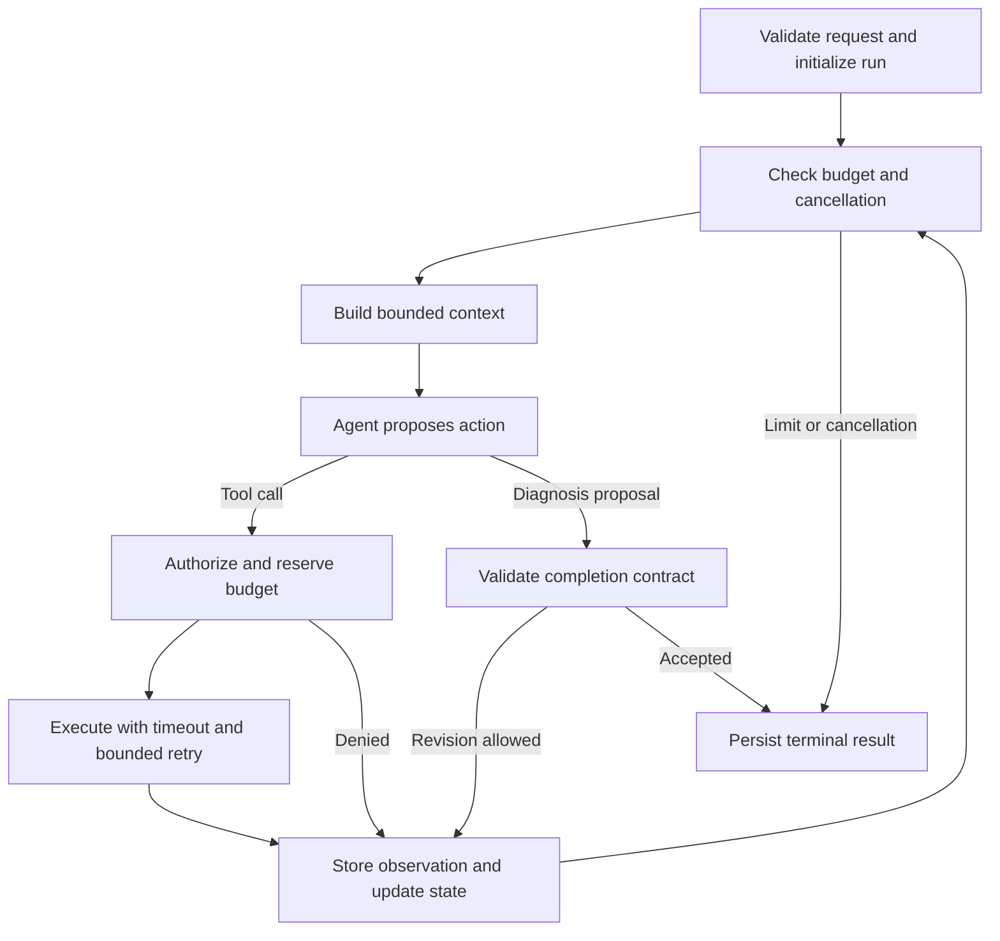

# TraceMind single-agent design

## Priority and current status

The next milestone is a reliable, observable single-agent diagnosis service.
Multi-agent orchestration follows an evaluated single-agent baseline.
The capabilities below are planned work unless explicitly marked current.

Current code provides a `create_agent` tool loop, five read-only telemetry
tools plus run-local evidence retrieval, normalized observations, structured
output, and one live payment-failure case. Telemetry defaults to discovered MCP
tools over Streamable HTTP; direct/stdio execution paths have been removed.
S1 adds per-run state, a tool registry and tool-name allowlist, model/tool call
budgets, identical-query limits, model/tool/run timeouts, completion checks,
and structured JSONL events. API and evaluation use the same controls; the
case's tool budget also constrains execution. Scripted-model tests exercise the
real agent loop, parallel admission, cancellation, isolation, and failure paths.

S2 adds a per-run observation store with exact deduplication, bounded previews,
a budgeted read_evidence tool, deterministic input reduction, and a conservative
input estimate plus enforced provider output cap. Compression retains evidence
references and tool-call/result pairing; oversized fixed input stops explicitly.
Store size limits retain partial evidence with a context_limit outcome.

Queued runs now have resumable checkpoints and durable evidence. S6 adds opt-in,
human-confirmed structured memory with fixed run snapshots. Service/tenant
authorization and full payload trace export remain pending. S1 disables SDK
retries and records provider usage when available. Its
event files contain operational metadata and evidence IDs, not full observations
or recoverable graph state. Optional DEBUG logging exposes the same sanitized
event metadata in the terminal without changing persisted events.
Trace file I/O failures produce a server warning while preserving in-memory
events and the primary run outcome. Expected external errors are classified as
model/tool errors; unexpected implementation errors retain `internal_error`
and their exception chain. API error `detail` stays a string, with run metadata
in response headers; timezone-aware inputs remain required.

## Agent and workflow responsibilities

### Optional RAG infrastructure

The separate `tracemind.rag` package implements the approved LightRAG baseline:
Qdrant vectors, NetworkX relationships, SQLite FTS5 BM25 recall, RRF fusion and
local BGE reranking. It exposes structured canonical knowledge chunks with
document hashes and source revisions. `mix` and `naive` share the same downstream
fusion and ranking. No knowledge enters diagnosis context automatically.

Explicit prepare/build/verify commands now select a manifest profile, verify
source-file hashes and pinned Git bytes, and parse Markdown, HTML, JSON and text
PDFs. Web sources retain access/version metadata without live verification.
Complete sections are canonical parents; LangChain recursive splitting uses
BGE token counts, section-local overlap and reversible original-text offsets
for children. The child budget includes title/section headers. SQLite persists
parents, children and both FTS5 indexes in a transaction.

LightRAG receives the prepared child IDs through its custom chunking pipeline.
Local BGE embeds chunks/entities/relationships and the injected LLM extracts
the graph. A build has one call budget, per-call limits and a total timeout.
Publication validates document status, canonical text across stores and graph
source references, then freezes local hashes with an atomic snapshot marker.
This is a publication gate, not a distributed transaction. Failures remain
unpublished and retry with a new ID; partial graph repair is not implemented.
Published SQLite is read-only and query caching is disabled. Local verification
does not verify Qdrant contents. Parents are available by ID but are not expanded
automatically during retrieval.

The empty bootstrap workspace remains unpublished. No Agent tool is registered.
Tokenizer limits prevent silent embedding/reranker truncation. Injected model
calls have bounded accounting; future Agent integration must also charge them
to the outer run budget.
The library accepts an async completion callback; the CLI owns provider
selection, credential loading and provider-specific request options.
An OS file lock grants one process ownership of each local workspace. English
query planning, online source/scope policy and knowledge-specific evaluation
remain required before enabling retrieval in diagnosis runs.

### Diagnosis execution

One diagnostic agent chooses queries, interprets evidence, revises hypotheses,
and proposes conclusions. Application code owns execution and termination.

| Step | Owner | Contract |
| --- | --- | --- |
| Validate incident and resolve scope | Workflow | Scope comes from trusted configuration or authenticated identity |
| Load state and compose context | Workflow | Apply context budget, evidence selection, and prompt version |
| Propose query or diagnosis | Agent | Structured proposal with evidence references |
| Authorize and execute tools | Workflow | Validate arguments, scope, budgets, timeout, and retry policy |
| Normalize and store observations | Workflow | Preserve provenance and return bounded evidence |
| Interpret evidence and choose follow-up | Agent | Distinguish observations, hypotheses, and missing information |
| Accept diagnosis or request revision | Workflow | Validate completion contract and bound repair attempts |
| Stop and publish result | Workflow | Persist terminal status, stop reason, and partial results |

Initially retain `create_agent` and use middleware for model/tool interception
and custom state. Add explicit graph nodes where tested requirements cannot be
expressed clearly through these hooks. Verify APIs against locked dependencies.

## 1. Context engineering

Compose model input from four layers:

1. Versioned system instructions: diagnostic method, evidence requirements,
   uncertainty, untrusted-data boundaries, and output contract.
2. Run context: incident, fixed time window, available tools, remaining budget,
   and policy feedback. Credentials stay outside model context.
3. Working notes: hypotheses, supporting/contradicting evidence IDs, completed
   queries, unresolved questions, and intended next checks.
4. Selected evidence and recent complete model/tool exchanges.

Store observations outside the prompt. Return bounded summaries, provenance,
and references for detail retrieval. Normalize, filter, deduplicate, and cap
fields/results before selecting relevant evidence. Preserve contradictions.
Deduplication must consider trace/span identity, timestamps, metric labels,
and error details; identical summary text does not establish duplication.

Summarize older exchanges only when needed. Keep tool-call/result pairs valid,
including pending responses. Summaries retain evidence IDs and never become
new observed evidence. On summary failure, use deterministic selection and
stored-detail references, or terminate with a context-limit reason. Any summary
model performs a bounded transformation without investigation tool access.

Budget the full input, including tool schemas, and reserve response tokens.
Distinguish estimates from provider usage. Measure evidence retention and
diagnostic accuracy after compression.

### MCP telemetry service and dynamic tool binding

The telemetry service is a standalone package in `services/otel-telemetry-mcp`
with its own dependency lock, configuration, HTTP entrypoint and Docker image.
It imports no TraceMind runtime modules. The service owns backend clients, typed
arguments, full tool guidance and normalized observation/reply schemas. TraceMind
validates received JSON into its existing Evidence model; neither package needs
the other installed. The wire schema is the compatibility boundary.

HTTP is the default application path. `HttpMcpClient` initializes one SDK
Streamable HTTP session and fetches paginated tool definitions with bounded
count, page bytes and discovery time. The generic tool binder filters names by
the existing run allowlist, uses server descriptions/schemas for LangChain and
injects fixed investigation timestamps according to server schema annotations.
No per-query implementation is used in this path. Local `read_evidence` is
registered alongside the remote tools and cannot be replaced by discovery.

Tool names are validated strings; the six existing names are default grants,
not a closed registry. The pure workflow policy intersects run/application
grants with task restrictions and optional trusted Agent grants. It persists
the resulting names in the existing run snapshot, with no database migration.
The model sees only admitted tools, and the harness repeats admission checks
for execution and retries. Future child-Agent grants must remain subsets of
the investigation grants. Multi-agent orchestration and shared budget ownership
are separate work.

The transport returns standard MCP results without tool-name dispatch. The
telemetry adapter is selected by the versioned result contract in tool `_meta`;
the exact legacy TelemetryReply output schema is also accepted. Domain
observations retain their existing validation, filtering, storage and citation
rules. Generic text/JSON is reference material, never automatically Evidence,
even if it contains IDs or resembles an observation. Generic results do not
receive stored-evidence compression indexes or implicit retries. Server result
contracts and preview hints describe handling; they cannot authorize tools.

Discovery runs inside diagnosis lifecycle/deadline handling, emits metadata
events and finishes before model dispatch. It is setup rather than a model or
query attempt. Local-only explanation and resumed finalization skip it. Query
admission, shared attempts, retries, no-progress detection, evidence retention,
context shaping and completion checks remain in the existing harness/workflow.
A dedicated task owns all SDK context entry/exit; closing it releases the HTTP
session without terminating the server. No automatic direct fallback is used.

The server uses JSON RPC responses over Streamable HTTP, maintains MCP session
connections rather than investigation state, and reuses backend HTTP pools.
Only typed observations become Evidence; metadata and safe error replies do
not. Both endpoints cap decoded replies. Server model keys, run databases,
checkpoints, long-term memory and agent execution are absent.

Deployment uses a separate Compose project joined to the Demo network, with
only localhost:8012 published. The default scope is a local machine; remote
hosting/authentication is not implemented. Direct clients, manually registered
telemetry wrappers and the original stdio implementation have been removed.
Offline replay binds recorded MCP definitions to synthetic replies through the
same tool binder. Historical records keep their old transport label.
This change does not establish multi-worker checkpoint ownership guarantees.

Validation covers real HTTP discovery and execution, server-owned descriptions,
application context binding, permissions, parallel budgets, retry accounting,
response limits, timeout/cancellation, evidence filtering, local-only operation
and scripted API/worker/evaluation execution. Container verification checks that
TraceMind and LangChain are absent. Live telemetry probes are separate from
model-quality evaluation, and offline replay remains in-process.

## 2. Run state and persistence

Introduce single-agent `RunState`: run/thread IDs, incident and time window,
access scope, lifecycle status, deadline, cancellation, bounded messages,
working notes, evidence references, pending calls, call/attempt ledger, usage,
failures, remaining budgets, diagnosis proposal, and stop reason. Record model,
prompt, policy, tool-schema, and application versions for reproducibility.

Run statuses include `queued`, `running`, `succeeded`, `inconclusive`,
`failed`, and `cancelled`. Keep these separate from diagnosis status: a provider
outage is an operational failure. Preserve partial evidence on failure.

Use persistent LangGraph checkpoints for graph state and a run/evidence store
for queryable records and artifacts. Start locally with SQLite; use PostgreSQL
for multiple workers. In-memory checkpoints are for tests. Persist call IDs,
budgets, and evidence references with recoverable state; recovery must not
reset budgets or lose the current in-memory evidence collector.

Checkpointing does not guarantee exactly-once external calls. Reuse durably
recorded results and record any re-execution after ambiguous failures. Keep
query windows fixed and record retrieval timestamps. Allow one active worker
per run. Define request idempotency, version compatibility, retention, and
startup/worker recovery; an in-process background task alone is insufficient.

Optional human collaboration groups independent runs under an investigation
ID. The first run remains autonomous; follow-up questions create new checkpoints
and budgets after the current round finishes. Explain rounds expose only
read_evidence; investigate rounds can query telemetry. New time windows filter
inherited observations. The bounded context includes recent user requests and
previous conclusions as untrusted historical claims, with evidence references.
Follow-up context prioritizes citations and interleaves services and sources,
including bounded normalized details and explicit omission markers. Explanation
answers the requested question, language and level of detail using the pack
first; necessary extra details use direct IDs or filtered catalogue reads.
Historical run results are preserved. This does not add cross-incident memory
or pause a running tool for human approval.

Metric discovery is a separately authorized read-only metadata tool. Distinct
name discovery avoids a series limit hiding every metric except one histogram;
targeted series lookup reveals its actual labels. Both name and series responses
are bounded by time, count and model-facing bytes. Metadata and empty-query
guidance have no evidence IDs and cannot count as new observational progress.
They help formulate queries but cannot substantiate a fault or its absence.
Observed failure propagation and inferred internal mechanisms remain distinct
in diagnosis prompts; semantic correctness still requires real-model review.

Readable progress is a projection of durable events through SSE. Cursor replay,
idle heartbeats and a committed terminal notification support reconnection;
subscriber disconnection leaves execution intact. SQLite schema v2 adds incident
records and run associations without changing checkpoint storage. The initial
implementation polls small event snapshots and is scoped to local deployment.

## 3. Long-term memory

Cross-incident memory is optional until its quality is evaluated. Persisting a
run does not automatically turn its contents into reusable knowledge.

Store confirmed resolutions, useful diagnostic queries, and service conventions
with provenance, service/environment scope, applicable version, verification
status, timestamps, and expiry. Promote diagnoses only after independent
confirmation or human review; model confidence is insufficient.

Retrieve a small relevant set and label it as historical experience. Support
correction and deletion. Versioned Runbooks remain a separate knowledge source.
Start with structured retrieval and add semantic search when cases justify it.
Evaluate with a frozen memory snapshot and held-out incidents. Ground truth
and evaluation labels must never enter diagnosis context or memory.

The first S6 increment is implemented with the existing SQLite ledger (schema
v3), typed manual confirmations, correction/reconfirmation, revocation and
deletion. Source runs require successful results and valid telemetry citations;
confirmation notes and identity remain trusted-local human attestations.
There is no automatic promotion, vector search or agent write tool. Retrieval
uses exact environment/version, affected-service overlap and explicit expiry.
Queued runs capture an opt-in policy and persist selected contents/revisions
before model execution; restart never refreshes that run's library view.
Historical hints are bounded separately and cannot become current Evidence.
Explanation rounds do not perform new incident-memory retrieval. Snapshots remain
in prior run records after edits or library deletion.

The feedback-learning increment adds local-user preferences/skills and inferred
human confirmations. `DiagnosisDraft.feedback_updates` is bounded to three
proposals in the existing model response; no extraction model or additional
call budget is introduced. The agent classifies ordinary feedback into lasting
habits, reusable investigation methods, temporary requests or human-reported
confirmed/corrected diagnoses. It reuses stable instruction keys and cites exact
current feedback quotes. No user request to remember or register is required.
Model confidence, questions and permission to try a repair are not confirmation.
This semantic classification depends on the model and remains to be evaluated.

Workflow validates quotes, source scope/observations, worker ownership and
concurrent revisions. SQLite v4 adds guidance records and transactional per-run
receipts. A receipt preserves original proposals and outcomes for idempotent
recovery, including after a human deletes the resulting library record. Invalid
proposals are reported separately from diagnosis acceptance. Preference/skill
snapshots are loaded even for explanation rounds; historical incident retrieval
remains disabled there. Guidance is scoped to one local user and survives
deployment-version changes. It is subordinate to current requests and execution
policy, and cannot grant permissions or become citable observations. Manual
review/edit/delete endpoints complement automatic inference. Automated human
confirmation can correct an inconclusive parent with observed telemetry and
stores its feedback run/quote; it is a human report, not independent machine
verification. Automatically confirmed records use a configurable 30-day expiry.
Autonomous/frozen evaluations neither read this live guidance nor write feedback
memories. A separate fixed-feedback benchmark is needed to measure learning.

Evaluations default to memory-off even when runtime memory is enabled. An
explicit frozen corpus predating the held-out window is required for memory-on;
retrieval excludes the same incident, late confirmations, wrong scope and
records expired by the evaluation start. Reports record corpus hashes and group
memory modes separately. Paired scripted replay checks the workflow; no claim
of improved real-model accuracy is made. Training/test separation still needs
dataset review because IDs cannot identify copied labels or future answer text.

## 4. Tool registry and permissions

Registry entries specify schemas, read/write capability, permitted scope,
timeout, result-size limit, retry classification, and concurrency limit. All
four current tools can remain visible to a run authorized to use them.

Filter visibility by policy and enforce the same policy at execution. Model
arguments cannot grant permission. Resolve scope from configuration initially
and authenticated identity for shared use; affected services are investigative
hints, not access boundaries. Enforce service/environment, time-range,
trace-detail, and query-cost restrictions. Free-form PromQL needs enforced
scoping or a scoped backend, not just prompt instructions. Validate result
sizes locally as well as requesting backend limits.

Retain read-only telemetry access. Any future mutation tools need defined
approval, idempotency, audit, and recovery behavior before exposure.

## 5. Loop control and recovery

Enforce budgets before starting work: model calls, tool calls, backend attempts,
elapsed time, context tokens, and output-token reservation. Count retries,
summary calls, and diagnosis repairs. Reserve budgets atomically for parallel
calls. Keep recursion limits as a final guard. Detect repeated equivalent
queries without progress, reuse results when appropriate, and terminate after
bounded feedback if no useful progress is possible.

Update usage from provider responses. Missing usage is unknown, not zero;
record estimates separately. Cost estimates carry a pricing version. Admission
estimates and output limits reduce overshoot but cannot guarantee an exact
provider-billing ceiling after ambiguous timeouts.

The agent proposes completion. Workflow code checks schema, evidence provenance,
scope, time relevance, and required diagnostic fields, then accepts or requests
a bounded repair. Require suspected service, failure mechanism, supporting and
conflicting observations, and unresolved questions. Evidence IDs prove
provenance, not causality. Multiple source types can describe the same event;
evidence counts and model confidence alone do not prove a root cause. Evaluate
causal quality against ground truth and reviewed cases.

| Failure | Response |
| --- | --- |
| Transient timeout, 429, selected 5xx | Bounded backoff with jitter within the deadline; respect Retry-After |
| Invalid arguments or query | Structured feedback for bounded correction; avoid blind retries |
| Access denial or missing credentials | Explicit access/configuration failure; no unchanged retry |
| Backend unavailable | Record failure; agent can use remaining authorized sources |
| Provider failure | Bounded retry; optional compatible fallback with recorded model switch |
| Malformed diagnosis | Bounded schema/contract repair |
| Tool budget, repeated calls, or no progress | Close tools; submit a validated diagnosis from existing evidence within remaining hard budgets |
| Model/context/graph exhaustion, deadline, cancellation | Stop under existing limits; persist partial results and explicit reason |
| Unexpected software error | Mark failed and retain diagnostic trace |

Choose one transport-retry owner and account for SDK retries explicitly.
Avoid multiplying SDK, middleware, and HTTP retries. Fallback is opt-in and
must be recorded separately in controlled evaluations. Empty results,
unavailable data, and contradictory evidence are distinct outcomes.

## 6. Tracing and operational interface

Persist run, model-call, tool-call, backend-attempt, context-reduction,
checkpoint, policy, and terminal events. Include run/span/parent IDs, sequence,
timestamps, duration, status, sanitized errors, and input/output references.
Model events record model/prompt version and token usage, including cache and
reasoning usage when exposed. Tool events record arguments, result references,
retry attempts, sizes, and reuse. Cover failure and cancellation paths.

Start with a persistent event sink and run summaries, then export OpenTelemetry
spans. Distinguish agent execution traces from application traces under
investigation. Console output becomes a view of these events. Record observable
actions and explicit diagnostic notes; private model chain-of-thought is not
part of the trace contract.

Redact structured fields and embedded text before persistence. Define artifact
retention and access. Large payloads use bounded previews and protected artifact
references. Add run creation/status/result/cancel/resume endpoints as persistence
lands. Keep the synchronous endpoint usable for short baseline runs. Shared
deployment also requires authentication, admission/concurrency limits, worker
recovery, dependency health, and retention controls.

## Delivery sequence and acceptance criteria

Each increment includes deterministic tests using scripted model responses and
mock telemetry, plus relevant live scenarios. The following are planned gates.

| Increment | Deliverable | Acceptance criterion |
| --- | --- | --- |
| S1: controlled loop (implemented) | Run state, registry/executor, completion gate, call/deadline budgets, structured events | Repeating model, parallel calls, invalid evidence, denied tool, and timeout terminate predictably; denied calls never reach the backend |
| S2: bounded context (implemented) | Observation store, evidence selection, context assembly, compression | Large/noisy results fit context allowance; critical/contradictory evidence stays retrievable; tool messages remain valid |
| S3: recovery (implemented; supports injected-failure testing) | Error taxonomy, retry ownership, fallback, no-progress detection | Injected 429/5xx/timeout/malformed output has bounded attempts, accounted usage, and useful terminal results |
| S4: persistence (implemented for local queued runs) | Checkpoints, run store, resume/cancel, scheduling recovery | Restart retains evidence and budgets; concurrent resume is controlled; cancellation stops new work |
| S5: evaluation and operations (evaluation increment implemented) | Broader cases, replay fixtures, metrics report, trace export, shared-service controls | Report accuracy, false completion, attempts, latency, usage/cost, and recovery; verify run isolation and trace coverage |
| S6: optional memory (first increment implemented; real-model quality pending) | Human-confirmed records, structured scoped retrieval, immutable run snapshots, provenance and expiry | Frozen memory-on/off replay; reject stale/unconfirmed/same-incident records and keep evaluation labels outside runtime |
| T1: independent telemetry MCP | Five server-defined tools discovered over Streamable HTTP; Docker deployment; direct/stdio removed | Real HTTP discovery/execution, harness gates, API/worker/evaluation wiring and container isolation; live-model quality remains unmeasured |

S3 implements harness-owned retries, opt-in model fallback, bounded diagnosis
repair, and observation-based no-progress detection, with injected-failure tests.
Tool budget, repetition, and no-progress limits enter a tool-free finalization
phase when model-call budget and time remain. The phase is recorded in durable
events; final output shares existing budgets and citation validation.
S4 adds a separate worker, SQLite run/evidence ledger, and LangGraph SQLite
checkpoints for queued runs. The synchronous API and evaluation paths still run
without persistent recovery. The two databases do not share a transaction;
external calls may be retried after an ambiguous crash, and consumed attempts
remain in the ledger. The local worker lease fences stale writers, while
shared deployment needs a stronger queue and checkpoint store. S1 and S2 have deterministic
execution tests. S2 uses exact-content deduplication and oldest-result reduction; it does
not perform semantic ranking, hypothesis extraction, or LLM summarization.
All original observations remain in the run-local store within its serialized
byte cap. The input estimator uses UTF-8 bytes plus framing allowance, not an
exact provider tokenizer. See README for configuration and limitations.
Record code/model/tool versions and expand evaluation during each increment.
Include missing telemetry, misleading upstream symptoms, conflicting evidence,
and operational failures. Ground-truth evaluation stays outside the runtime
completion gate. Multi-agent and RL follow this baseline; MCP telemetry is
implemented as described above.

## Framework references

- [LangChain middleware](https://docs.langchain.com/oss/python/langchain/middleware/overview)
  provides hooks around model/tool execution inside the current agent.
- [Prebuilt middleware](https://docs.langchain.com/oss/python/langchain/middleware/built-in)
  covers summarization, call limits, retries, and model fallback. Domain
  authorization, evidence checks, and unified budgets remain application work.
- [LangGraph persistence](https://docs.langchain.com/oss/python/langgraph/persistence)
  distinguishes thread checkpoints from cross-thread stores.

### Storage and service boundaries

`models/result.py` and `models/storage.py` own result/snapshot contracts without
importing the execution service. `agent/storage/database.py` owns schema initialization
and transactions, `persistence.py` owns run lifecycle storage, and
`memory_repository.py` owns memory/feedback transactions. Pure follow-up
selection and permission policy lives in `followup.py`; memory provenance and
feedback planning live in `memory_policy.py`. Source-run reads,
lease checks and feedback receipts stay in one SQLite transaction.

`runner.py` adapts the LangChain graph; `preparation.py` builds historical and
user context; `validation.py` validates citations. `service.py` coordinates
these steps and owns terminal cleanup. `factory.py` assembles API, worker and
live evaluation dependencies, with explicit evaluation memory overrides.

Storage I/O runs off the event loop. The harness reserves attempt counters
without yielding, commits a copied snapshot under a per-run async lock, then
executes external work. Results and rejected/skipped tool transitions are
committed before returning to the graph. An interrupted storage await drains
the underlying thread operation before propagating cancellation. API stores
are initialized once per app/database path in the request thread pool.
