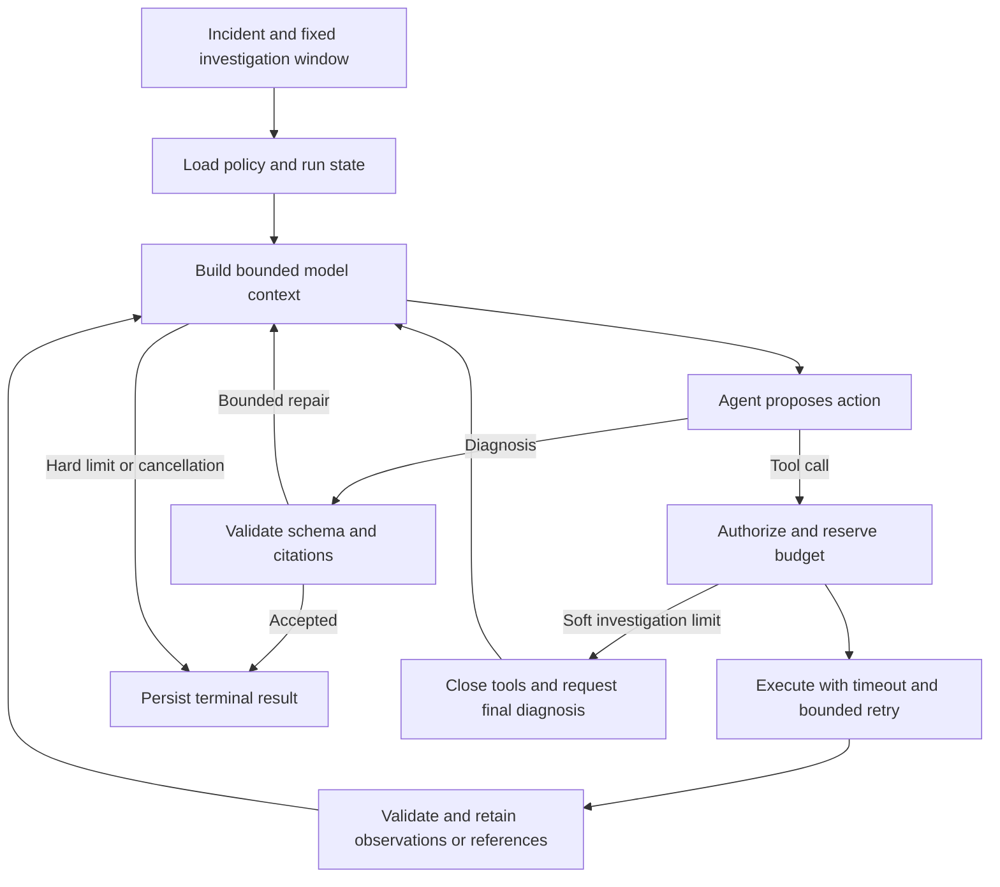

# TraceMind design

TraceMind is a portfolio-oriented incident diagnosis system for controlled
microservice faults. A single agent chooses queries and interprets results;
application code owns permissions, execution, state and termination.

This document describes the current implementation. Feature changes are in
[CHANGELOG.md](CHANGELOG.md); setup and API usage start in [README.md](README.md).

## Execution flow

The agent uses LangChain `create_agent` and LangGraph. API, worker and live
evaluation share service assembly. Synchronous diagnoses execute in the request;
queued runs execute in a separate worker with persistent recovery.

## Component ownership

Paths below are relative to `src/tracemind/`.

| Component | Responsibility |
| --- | --- |
| `api/` | Request validation, run/investigation routes and SSE projection |
| `agent/factory.py` | Shared model, transport and service assembly |
| `agent/service.py` | Diagnosis lifecycle and terminal cleanup |
| `agent/runtime/` | Graph adapter, harness, context controls, tools and knowledge integration |
| `agent/workflow/` | Preparation, follow-up selection, grants and citation validation |
| `agent/storage/` | SQLite transactions, run lifecycle, evidence and memory repositories |
| `agent/memory/` | Feedback provenance and guidance planning |
| `models/` | Incident, evidence, diagnosis, run and storage contracts |
| `mcp/` | HTTP session, discovered-tool contracts and result adaptation |
| `rag/` | Corpus preparation, snapshot publication and retrieval |
| `evaluation/` | Langfuse task adapters, evaluators, experiments and fault fixtures |
| `observability/` | Optional Langfuse client and tracing context |

The independent `services/otel-telemetry-mcp/` package owns telemetry HTTP clients,
normalization and tool definitions. It imports no TraceMind or LangChain code.
The pinned OpenTelemetry Demo stays in a sibling checkout; its built-in agentic
mode is excluded from diagnosis.
Why: Preserve independent deployment and keep diagnosis attributable to TraceMind.

## Tools and evidence

Live telemetry uses MCP Streamable HTTP. Initialization fetches paginated
`tools/list` definitions under time/count/byte limits. The generic binder exposes
only granted names and injects fixed investigation timestamps using server schema
annotations. Parallel calls share the session; closing it leaves the server running.
Local-only explanation and resumed finalization skip discovery. Discovery is setup
inside the run deadline, not a model or query attempt.

Application grants, task restrictions and optional trusted Agent grants are
intersected and saved in `RunState.allowed_tools`. The harness checks grants again
at execution and retry admission. Model output and server metadata cannot grant
access. Defaults are five read-only telemetry operations plus local `read_evidence`;
optional knowledge tools require explicit grants.
Why: Discovery and model output must not expand the application permission boundary.

| Result | Treatment |
| --- | --- |
| `telemetry.v1` observations | Validate, filter by window, deduplicate and retain as Evidence |
| Metric discovery metadata | Query guidance without evidence IDs or observational progress |
| Generic MCP text/JSON | Reference material, never implicit incident evidence |
| Knowledge hits | Retained source references with separate citation validation |

The telemetry contract is selected by metadata; the exact legacy reply schema is
also accepted. Preview hints cannot expand local limits. Generic tools have no
implicit retries because side effects are unknown. Old stored `direct` labels
remain readable, but live direct/stdio paths are gone. Replay uses recorded schemas
and the production binder without contacting MCP.
Why: Preserve historical readability while exercising the same binding contract offline.

Complete diagnoses require unique, known telemetry citations inside the fixed
window. Knowledge or memory cannot replace current observations. Empty results do
not establish health. Observed failures and hypotheses about their internal
mechanism remain distinct. Citation validation proves provenance, not causality.
Tool-name grants and affected-service hints do not provide service/tenant isolation;
shared use needs enforced backend scope and identity-based authorization.
Why: Citation provenance and tool names cannot prove causal truth or isolate tenants.

## Context and loop controls

Runs retain full normalized observations within a serialized byte cap. Exact
duplicates share the first evidence ID; different timestamps, queries or attributes
remain distinct. Tools return bounded previews with explicit omissions. Authorized
`read_evidence` calls page stored catalogues or JSON without another backend query,
using the same tool and time budgets.
Why: Retained evidence remains inspectable without creating an uncounted external-query
path.

Before each model call, middleware estimates serialized input including tool and
diagnosis schemas and reserves output capacity. The estimator uses UTF-8 bytes plus
framing allowance, not a provider tokenizer. Provider-reported usage is separate;
missing usage is unknown, not zero.
Why: Conservative context estimates must not be presented as measured provider
consumption.

Compression replaces oldest tool results with evidence indexes and, when readers
are authorized, bounded previews. Tool-call/result pairing and the newest requested
detail page are preserved. Stored observations and graph history remain available.
There is no semantic ranking, working-note extraction or summarization model.
Unfit input or evidence capacity ends with `context_limit` and partial evidence.
Why: Keep structural context and observations intact instead of silently dropping
counterevidence.

The harness reserves attempts before yielding, including parallel calls. Retries,
repairs, evidence reads and auxiliary RAG calls consume their relevant shared
limits. Graph recursion is an additional guard. SDK retries are disabled; the
harness owns bounded retry accounting and optional model fallback.
Why: Every real attempt must consume the same run budget and deadline.

| Condition | Behavior |
| --- | --- |
| Transient model/telemetry failure | Bounded retry within the deadline; fallback only when configured |
| Invalid tool arguments or query | Sanitized correction feedback; no unchanged blind retry |
| Missing, malformed or invalid diagnosis | Bounded structured-output/citation repair |
| Tool budget, repeated call or no progress | Close tools; request diagnosis using supplied evidence |
| Model/context/graph exhaustion, deadline or cancellation | Stop under existing limits and retain partial state |
| Unexpected implementation failure | Operational failure with diagnostic metadata |

Finalization grants no extra attempts, time, context or repair allowance. Its
durable phase event keeps tools closed after recovery. Run lifecycle (`queued`,
`running`, `succeeded`, `inconclusive`, `failed`, `cancelled`) is separate from
diagnosis content and confidence.
Why: Recovery and final synthesis must not reopen tools or create extra execution
allowance.

## Persistence and collaboration

Queued runs use a SQLite run/evidence ledger and separate LangGraph checkpoints.
RunState retains incident/window, limits, grants, attempts, evidence, usage, policy
snapshots and stop reason. Worker leases and heartbeats control local recovery;
consumed attempts and deadlines survive restart.

Storage callbacks run outside the event loop. Admission awaits a copied, serialized
durable snapshot before external work; results are committed before returning to
the graph. Cancellation drains in-flight storage so late progress cannot overtake
terminal cleanup. Feedback ownership, revision checks and receipts share an explicit
transaction in the ledger.
Why: Draining storage and transactional feedback prevent late writes from overtaking
terminal state.

The ledger and checkpoints have no shared transaction. A crash after an external
response can cause re-execution: checkpoints do not guarantee exactly-once calls.
Lease checks fence ledger writes, but checkpoint writes do not enforce lease
ownership. Supported deployment is one local worker. Back up both stores together.
Why: Separate stores cannot guarantee exactly-once execution or safe concurrent
checkpoint writers.

An investigation groups independent rounds under one incident. Each gets its own
checkpoint, budget and result. Follow-ups inherit bounded historical context; new
windows filter inherited observations. Prior conclusions and user hypotheses are
untrusted claims. Explanation uses authorized retained-data readers only; further
investigation may query telemetry. An active round blocks new questions and earlier
results stay available.
Why: Each question needs its own accountable execution while historical claims stay
distinguishable from observations.

SSE projects durable events, replays by cursor and notifies termination after commit.
Subscriber disconnection leaves the run active. JSONL is best-effort sanitized
operational metadata, not checkpoints or full payloads. Reports and SQLite may
contain full evidence and feedback.
Why: Observers must not control execution, and operational logs need a narrower payload
boundary than durable results.

## Optional knowledge and memory

| Source | Content and boundary |
| --- | --- |
| Incident history | Prior rounds and retained evidence for the same investigation |
| Published RAG snapshot | Versioned documents, canonical chunks and source provenance |
| Confirmed incident memory | Human-attested historical resolutions with scope and expiry |
| User guidance | Preferences/skills inferred from quoted follow-up feedback |

RAG uses Docling structural parsing, LightRAG graph/vector recall, SQLite FTS5/BM25
recall, LangChain rank fusion and one local BGE rerank. Publication checks canonical
IDs, graph sources and local hashes. Published snapshots are immutable; parser or
configuration changes require a new snapshot ID.
Why: Immutable IDs keep provenance and retained references reproducible.

Online policy is pinned at admission. Searches retain children/full parents in
RunState; follow-ups can read saved sources without a retrieval backend. The
application assembles provider callbacks. Auxiliary calls share harness accounting
and reserve final-synthesis capacity. Embedded searches own their callback and
runtime while sharing local weights and admission locks. The configured HTTP
service owns prewarmed models, a private store copy and the snapshot lock for its
process lifetime. See [online integration](docs/rag-online-integration.md)
for ownership details.
Why: Shared weights must not share the calling investigation's paid-call state or
callback closure.

Memory is disabled by default. Scoped retrieval excludes stale, revoked and
same-incident records and freezes selected contents before model execution.
Corrections/deletion affect future retrieval; prior snapshots remain auditable.
Explanation does not retrieve new historical diagnoses.
Why: Scope, expiry and same-incident exclusions prevent stale or leaked answers from
becoming current evidence.

Feedback learning proposes at most three updates in the existing diagnosis response.
Workflow validates current quotes, source observations, worker ownership and
revisions, then writes updates with an idempotent receipt. Temporary requests are
not promoted. Current requests and policy override saved guidance. Model confidence
alone cannot confirm a resolution; classification quality needs real-model evaluation.
Why: Human quotes, source provenance and idempotent writes prevent model confidence or
replay from fabricating learning.

## Evaluation and remaining boundaries

Scripted tests and fixed telemetry replay exercise actual workflow paths, including
recovery, persistence and citation gates. Their scores/timings do not measure real
model accuracy or network latency. Code evaluators check execution, citations and
provenance; the optional Judge reviews semantic support and held-out correctness.
Neither establishes causal truth. Ground truth and relevance labels stay outside
investigator/retrieval inputs.
Why: Labels and deterministic replay must not inflate apparent diagnostic quality.

Memory evaluation uses frozen pre-incident corpora, never live user guidance.
Retrieval Recall/MRR/nDCG is separate from diagnosis quality. RAG/memory off/on
comparisons need controlled windows, tools and budgets with separate cost/latency.
Why: Comparable inputs and explicit costs are necessary to attribute changes to memory
or retrieval.

Optional runtime trace export is implemented through Langfuse. Remaining work
includes broader real-model evaluation, authentication, tenant/source authorization,
retention controls, automatic alert ingestion, distributed retrieval and worker
ownership guarantees. Before adding
workers, enforce checkpoint ownership and test process-level takeover/stale-writer
races. Multi-agent work follows an evaluated single-agent baseline; mutation tools
and reinforcement learning are outside current scope.
Why: Checkpoint fencing and a measured baseline are prerequisites for expanding
execution ownership.

## Online completion verification and evaluation

When enabled, a frozen run policy reserves one existing model-call slot for a
tool-free review after citation validation and before diagnosis acceptance. All
retained telemetry, knowledge and execution events enter the review. Rejection
returns inconclusive; malformed/unavailable review fails the run. No automatic
repair is performed. Completed reviews survive recovery; ambiguous interrupted
attempts fail closed. The harness remains responsible for call/time budgets, usage accounting, cancellation,
checkpoints and termination.
Why: A reviewer must not bypass harness controls or repeat an ambiguous paid attempt
after restart.

Langfuse stores datasets, experiments, scores and optional runtime tracing.
Offline Judge and online verifier share review contracts and proof obligations;
only offline evaluation receives held-out correctness labels.
Why: Runtime acceptance must be based on retained observations rather than leaked
reference answers. Scripted replay
lives under tests and measures harness behavior. The independent RAG service
and its retrieval policies remain owned by the RAG module. See
[evaluation](docs/evaluation.md) for configuration and calibration limits.
