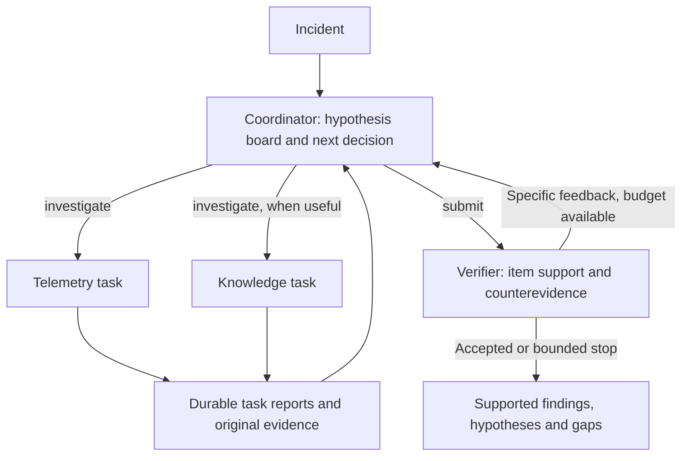

# Collaborative diagnosis

`TRACEMIND_AGENT_MODE=multi` selects the LangGraph `graph-v6` workflow.
Single-agent remains the application default. Both modes share tool permissions,
immutable evidence, run-wide admission budgets, persistence and the same verifier.

The coordinator returns one decision: delegate one or two tasks, or submit a
candidate. Roles are selected dynamically; two telemetry tasks are legal.
Knowledge tasks require a configured published snapshot. A shared board retains
up to six competing hypotheses, supporting and contrary telemetry references,
knowledge references, and missing observations. Specialist tasks name the board
hypotheses they investigate; initial discovery needs no preselected hypothesis.

`read_evidence` and `read_knowledge` only page retained records. Empty catalogues
at startup do not establish that a backend search returned nothing. The
coordinator delegates initial telemetry discovery when permissions and budget
permit, and does not receive empty catalogue readers. Failed or empty specialist
attempts may still lead to a justified inconclusive result.

## Bounds and partial results

There are at most six coordinator decisions, three investigation batches and
three verifier rounds. Each batch has at most two concurrent tasks. Remaining
model/tool budget, global deadline and cancellation can stop earlier. Before a
new batch, admission reserves specialist tool/report turns, coordinator output,
configured repairs and verification. With one repair allowance and two verifier
slots, an initial one-task batch needs at least eight total model slots; two
tasks need ten. These are admission minima, not promises of successful diagnosis.

Before dispatch, the first batch receives half the remaining tool attempts
(rounded down, at least one when any remain), divided across new tasks. Each
task persists its fixed allowance and used attempts; retries and local readers
consume this allowance, while successful cache reuse does not. An exhausted
specialist submits its report without ending siblings or the whole run. Later
batches can use the remaining shared pool. This leaves capacity after the first
batch; it does not guarantee a dedicated later verification call, because
coordinator reads also consume the shared pool. Completed reused tasks receive
no new allowance. Interrupted reservations remain charged after recovery.

Specialists return at most six atomic findings with separate supporting E,
contrary E and knowledge K references, plus explicit missing observations.
Original telemetry establishes incident facts; knowledge establishes documented
semantics. A reference may support one assertion and oppose another, but cannot
be duplicated within the same list. A hypothesis is not promoted to an observed
fact merely because another agent repeats it.

Specialist timeout, exhausted local reserve or invalid report leaves a failed or
incomplete task record. Valid sibling results and original evidence survive.
Permissions, cancellation and the global deadline remain run-wide controls.
The coordinator can revise a rejected assertion directly from retained evidence;
verifier feedback does not force another remote query. After feedback bounds are
exhausted, supported items are retained separately from hypotheses and gaps.
An interrupted revision can retain an earlier review only when its candidate,
items, evidence, knowledge and query-history hash still matches. New observations
or searches invalidate that reuse. Terminal budget notifications alone do not. A later verifier outage may return
a still-current earlier supported partial. A first verifier failure or a stale
previous review remains a failed run; the newer unreviewed draft is never used.
Rejected candidate items are cleared before evaluating the actual partial answer.

The coordinator context prioritizes the originals cited by current reports and
explicitly lists omissions. Full-request admission also counts JSON escaping,
output schemas and runtime messages. Candidate support and review counterevidence
remain prioritized across feedback rounds. When tools are closed, the packet
marks detail readers unavailable and limits conclusions to supplied originals.
Local readers page retained records while investigation remains open. The latest
explicitly requested catalogue page may compact its fields, but cannot hide
references while retaining its original next cursor. If the complete compact
page does not fit, admission stops with a context limit. Older pages remain
compressible and originals remain stored. The verifier
receives all retained observations, not only agent-selected support; an oversized
review fails explicitly rather than silently deleting counterevidence.

## Shared execution and recovery

The supported deployment remains one local worker, with parallel tasks inside a
run. The harness owns model/tool admission, event sequence and serialized ledger
publication. Only the coordinator writes the candidate diagnosis. Task-keyed
reducers accept identical replayed completions and reject conflicting writes.

Identical read queries coalesce in flight. Successful query results are cached
within the run ledger, with a 256 KiB cap. Cache keys include arguments, fixed
window, knowledge snapshot and permissions. There is no cross-run query cache.
Mutable catalogue readers remain uncached. Failed/cancelled results are not
cached, and cancellation releases waiters. Reuse is visible in events and does
not charge another backend attempt.

The durable ledger records decisions, task status, reports and review feedback.
Separate LangGraph checkpoints preserve each child model/tool exchange. Tests
cover interruption at dispatch, join, submit, feedback and completion, plus the
boundary after a child checkpoint but before ledger application. Completed
children are reused without charging their model call again. A crash after a
provider response but before durable completion can still repeat an external
call; prior admission remains charged. Exactly-once external execution is not
claimed. Existing worker leases fence publication after ownership loss.

`graph-v6` rejects older workflow versions rather than silently reinterpreting
saved state. Keep the experiment/deployment profile fixed during recovery:
verifier policy is persisted, but primary/fallback model construction still uses
the current deployment settings.

## Evidence, retrieval and model configuration

Trace detail supports service/operation filters and deterministic pagination of
all spans, including fast controls. Coverage records the full/matched counts,
next offset and trace fingerprint. Diagnostic attributes retain operation,
status, dependency/database context and allowlisted application fields. User
identity is hashed in normalized attributes. Raw source log messages and query
text can still contain identifiers; this is not a general anonymization layer.
Logs can be narrowed to a trace ID.

Retrieval uses the published snapshot's graph/vector candidates and BM25, RRF
fusion, deduplication and BGE reranking. The HTTP service validates snapshot
identity, exposes the actual policy and returns compact candidate/count/score
metadata. The calibrated cutoff belongs to a specific snapshot, model revision
and development set. A small calibration set does not establish a universal
relevance threshold. Source validation and independent E/K types still apply.

Diagnosis, fallback, verification and retrieval use independently configured
model roles. Retrieval preparation assumes English input and preserves exact
identifiers without translating the query. Thinking tokens consume provider
output limits. Context admission uses a conservative UTF-8-byte estimate rather
than an exact provider tokenizer; configure limits using [.env.example](../.env.example).

SDK retries are disabled; harness attempts own retries and budgets. Evaluation
call admission also counts auxiliary retrieval, verification, offline Judge and
failed attempts. Unknown outcomes remain charged. Size the model, review and
run deadlines together; review timeout includes its format repair.

## Tracing and evaluation

Langfuse instrumentation includes coordinator/specialist spans, LLM generations,
MCP calls, verification and retrieval stages. HTTP retrieval propagates W3C
trace/parent IDs, excludes readiness polling, and records HTTP failure status.
An in-memory exporter test clears context at the HTTP boundary and verifies the
resulting ancestry. Live trace readback must additionally demonstrate that a
particular trial actually invoked retrieval; a successful publication check
alone only confirms scores and some observations. Shared callback identity avoids
counting one nested model invocation twice. Retrieval HTTP spans should share
the agent trace and sit under the role observation.

Synchronous evaluation calls the service directly. Its JSONL, usage admissions
and final output are evaluation records; setting database filenames does not
activate queued worker/checkpoint recovery. Validate recovery separately
through SQLite/worker tests and controlled worker interruptions.

Online verification tests evidence support without gold labels. The offline
Judge alone receives `demo-rca-v2`: owner, operation, observable mechanism,
propagation and forbidden overclaims. All five components must match for root
cause correctness. This is reported separately from strict acceptance, source
citation requirements, unsupported claims and false completion. Correctness is
null when no held-out reference is supplied.

Capture scripts reproduce the fault independently, retain correlated requests
and controls, verify input hashes, and restore the exact prior flag bytes. An
invalid capture does not enter paid diagnosis. Independent trials retain all
failures and source/configuration identity. Compare single and multi with the
same validated window, models, snapshot, tool grants and budgets; separate
development tuning from frozen comparisons. Repeated windows reduce sampling
noise but five known scenarios do not establish general production accuracy.
See [evaluation](evaluation.md) for experiment setup and comparison methods.

### Reference protocol and mechanism checks

The current `multi-agent-graph-v6-rca3` uses `graph-v6` task allocations.
It asks independent tasks to resolve different questions and prioritizes an
available owner-scoped check when the observed failing operation still has
competing mechanisms. Lack of budget or access remains an explicit gap; the
workflow does not require every telemetry type on every incident.

At the model-output boundary only, an ASCII positive decimal in a typed
citation list can receive its field's `E` or `K` prefix when that exact handle
already exists. No prose, item ID, event sequence, unknown handle, wrong prefix,
whitespace or Unicode number is corrected. Raw AI messages remain intact.
`reference.normalized` records the path, raw/canonical strings, LangChain AI
message IDs (not provider request IDs) or verifier attempt. The existing
duplicate, ownership, window and semantic checks still run; formatting repair is not evidence of causal correctness.
The offline Judge includes the same repair audit with attempt numbers.

MCP span `observed_at` means Jaeger `startTime`; the span end is start plus
`duration_ms`, subject to clock skew. Trace-summary time refers to the earliest
selected span, not collection or completion time. Page fingerprints cover all
normalized span observations before filtering, excluding generated evidence
UUIDs and volatile backend warnings. A repeated read with changed warnings but
unchanged exposed data retains its fingerprint.
